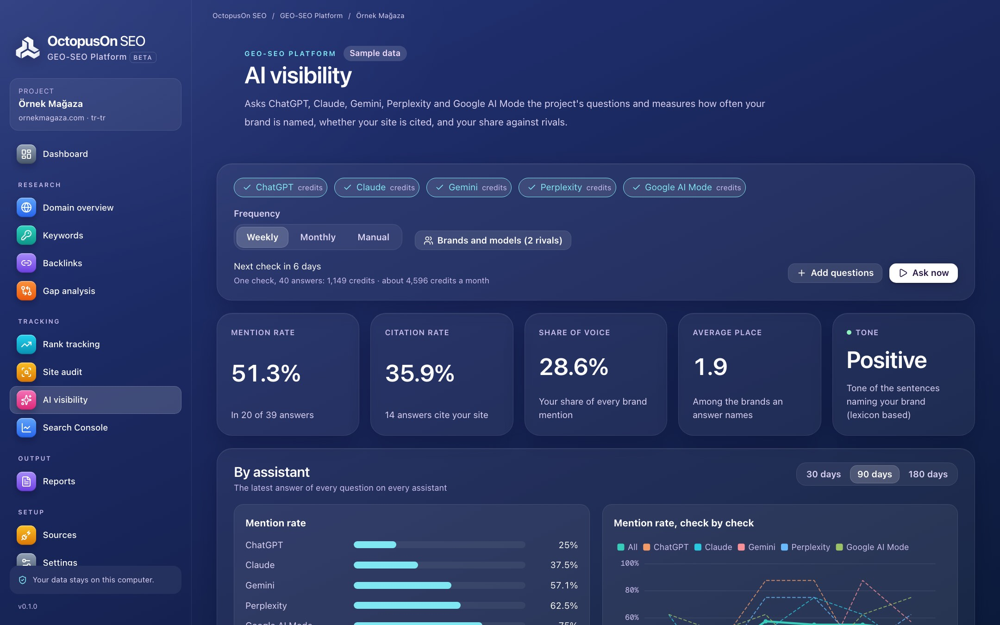

# OctopusOn GEO-SEO Platform

An all-in-one SEO and GEO platform and an alternative to Ahrefs and Semrush: domain overview, keyword research, backlinks, gap analysis, rank tracking, site audits and AI visibility in ChatGPT, Claude, Gemini, Perplexity and Google AI Mode. The program is free; you pay only for the data you use, with your own API keys or OctopusOn credits.

**Free and open source program**, no subscription · for SEO and GEO (visibility in AI answers) · Windows, macOS, Linux and the web at [app.octopuson.com](https://app.octopuson.com).



## Download

Get the installer for your system from the [latest release](../../releases/latest): `.dmg` for macOS (Apple Silicon and Intel), `.msi` or `.exe` for Windows, `.AppImage`, `.deb` or `.rpm` for Linux. More on [octopuson.com](https://octopuson.com/en/geo-seo-platform).

**macOS:** the app is not notarized by Apple yet, so on first launch macOS says Apple could not verify it is free of malware. Drag the app to Applications, run this command once in Terminal, then open it again:

```bash
xattr -dr com.apple.quarantine "/Applications/OctopusOn GEO-SEO Platform.app"
```

Or close the message, open **System Settings → Privacy & Security** and click **Open Anyway**. On Windows, if SmartScreen warns about an unknown publisher, choose **More info → Run anyway**.

## What it does

### Keyword research, domain overview and backlinks

Look at any domain or keyword in your project's country and language, and keep what you fetch.

- Domain overview: organic and paid keywords, traffic and traffic value, position spread and 24 months of history
- Organic keywords, top pages, organic competitors and subdomains, 100 to 1,000 rows at a time
- Keyword Explorer: up to 700 keywords at once, ideas, questions, related searches, the live top 10 and Yandex Wordstat
- Free Google and Yandex autocomplete, and keyword lists grouped into topics one page can target
- Backlinks: OA authority, live, new, lost and broken links, referring domains, anchors, and referring domains won and lost over 12 months
- Gap analysis against up to 5 competitors: missing keywords, shared keywords where they rank higher, and sites that link to them but not to you

### Rank tracking with Search Console and Analytics

Follow keyword positions over time and see them next to your own Google data.

- Google, Bing and Yandex; up to 10 locations by country, language, device and city; up to 5,000 keywords
- Daily, weekly or manual checks; on the web they run on the server even when nobody is signed in
- Visibility, average position, movement, competitor share, featured snippets and cannibalisation
- AI Overviews on the result page, and whether they cite your site
- Search Console and Google Analytics 4: queries, pages, devices, countries and organic sessions against the period before, with no data cost

### Site audit and GEO readiness

Crawl your site, run 118 technical SEO checks and measure how ready it is for AI answers.

- A health score and a GEO readiness score, each compared with the previous audit
- AI search crawlers and AI assistants in robots.txt: OAI-SearchBot, PerplexityBot, Claude-SearchBot, ChatGPT-User and more
- llms.txt, snippet limits, structured data, Organization and WebSite schema, question headings and substantial content
- On the desktop the crawl runs on your computer, up to 100,000 URLs, at no cost
- On the web the server crawls public sites up to 5,000 URLs; the first 1,000 pages each month are free

### AI visibility in ChatGPT, Claude, Gemini, Perplexity and Google AI Mode

Ask AI assistants the questions your customers ask, and measure how often they name and cite you.

- Up to 200 questions per project, with free suggestions from your brand and tracked keywords
- Mention rate, citation rate, share of voice against up to 10 rival brands, average place and tone
- The domains assistants cite most, and which of your pages they cite
- Your own OpenAI, Anthropic, Gemini and Perplexity keys, or the assistants through DataForSEO
- LLM Mentions: questions whose AI answers mention your domain, with their AI search volume

### White-label reports for agencies

Send clients reports with your brand, drawn from data the modules already hold.

- Your company name, logo, accent colour, website and footer line; the OctopusOn line can be hidden
- Rankings, competitors, Search Console, site audit, AI visibility and backlinks, in the order you choose
- Reports in Turkish, English, German or Spanish, whatever the interface language
- PDF, Excel and HTML downloads
- On the web, read-only share links and weekly or monthly e-mails to up to 5 recipients

### AI assistants and the command line

Ask your SEO questions in Claude, ChatGPT or Cursor and get answers from your own projects.

- An MCP server on the desktop (octopuson-platform mcp) and on the web (app.octopuson.com/mcp with personal access tokens)
- Assistants read kept data first; for fresh data they state the price and wait for your approval
- Five ready agent skills: site audit, keyword research, competitor analysis, GEO visibility and a weekly SEO coach
- The octopuson-platform command runs any command with JSON in and out, for scripts and scheduled jobs

## Command line

Every feature also works from the terminal with `octopuson-platform`, included in the release archives:

```bash
octopuson-platform projects
octopuson-platform call rank_report '{"project_id":1}'
octopuson-platform mcp
```

## In the browser

The same program runs at [app.octopuson.com](https://app.octopuson.com): sign in with your OctopusOn account, and scheduled work runs while your computer is off.

## AI assistants

Claude, ChatGPT, Cursor and other MCP clients can read your projects: start `octopuson-platform mcp` (or the desktop program with `mcp`), or connect to `https://app.octopuson.com/mcp` with an access token. They state the price and wait for your yes before buying data. Ready-made agent skills are in [skills/](skills/).

## Your own APIs or OctopusOn credits

The program is free; the data it shows comes from providers. Connect your own keys (DataForSEO, OpenAI, Anthropic, Gemini, Perplexity) and pay them directly, or use them with prepaid credits through one connection at [my.octopuson.com](https://my.octopuson.com). Every paid request shows its price first; Search Console and Analytics are read free with your Google sign-in.

## Source code and issues

This project publishes the releases of the GEO-SEO Platform. Its source code lives in [octopusOn/octopusOnPageSEO](https://github.com/octopusOn/octopusOnPageSEO), together with the engine every OctopusOn SEO program shares. Bug reports and ideas are welcome in this project's issues.

## Licence

MIT or Apache-2.0, at your option.
