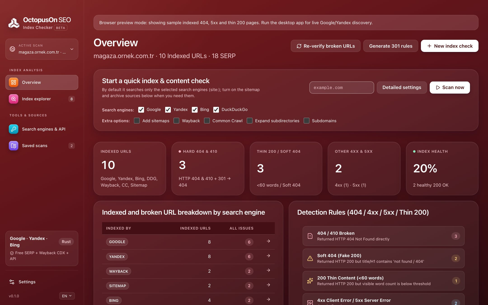

# OctopusOn Index Checker

A free Google index checker for broken indexed pages: find URLs that Google, Bing and Yandex still show but your site answers with 404s, server errors, soft 404s or thin content, and get 301 redirect rules ready to deploy.

**100% free and open source** (no paid version, no trial, no limits) · for SEO and GEO (visibility in AI answers) · Windows, macOS and Linux · updated continuously as search engines and AI assistants change.



## Download

Get the installer for your system from the [latest release](../../releases/latest): `.dmg` for macOS (Apple Silicon and Intel), `.msi` or `.exe` for Windows, `.AppImage`, `.deb` or `.rpm` for Linux. More on [octopuson.com](https://octopuson.com/en/index-checker).

## What it does

### Find the URLs search engines still remember

Free sources first, optional APIs when you need more.

- site: searches on Google, Bing, Yandex and DuckDuckGo in a browser you watch, no key needed
- XML sitemaps, robots.txt, extra keywords and ready-made search operators
- URL lists pasted in or imported from Search Console and Yandex Webmaster
- Optional Serper and SerpApi with your own key or OctopusOn credits
- Wayback Machine and Common Crawl marks for URLs that were archived

### Check every indexed URL like a crawler

Each URL is fetched with its redirects followed and sorted by what needs fixing.

- 404 and 410, other 4xx, 5xx errors and redirect loops
- Soft 404s from the page text, redirects to the home page, canonicals or meta refresh
- Thin pages, noindex pages, broken sitemap URLs and orphan indexed pages

### Fix it in minutes with 301 redirects

Turn the findings into redirect rules and lists your developers can deploy.

- 301 and 410 rules for Nginx (with directory wildcards), Apache, Caddy, IIS, Cloudflare, Vercel and Next.js
- WordPress and Shopify redirect CSVs
- Removal lists for Search Console and Yandex, a clean sitemap and IndexNow lists
- Suggested 301 targets you review URL by URL

### Track index health over time

Every scan is saved, so you can prove a cleanup worked.

- Index health score and per-directory clusters
- Scan comparison: resolved, new, persistent and dropped from the index
- Re-check single URLs after a fix
- Excel, CSV, JSON and Markdown reports

## Command line

Every feature also works from the terminal with `octopuson-index`, included in the release archives:

```bash
octopuson-index scan example.com
octopuson-index redirects latest --format nginx -o redirects.conf
```

## Your own APIs or OctopusOn credits

Everything that runs on your computer is free. Search APIs are optional: connect your own keys (DataForSEO, Serper, SerpApi, Yandex), or use all of them with prepaid credits through one connection at [my.octopuson.com](https://my.octopuson.com).

## Source code and issues

This project publishes the releases of the Index Checker. Its source code lives in [octopusOn/octopusOnPageSEO](https://github.com/octopusOn/octopusOnPageSEO), together with the engine every OctopusOn SEO program shares. Bug reports and ideas are welcome in this project's issues.

## Licence

MIT or Apache-2.0, at your option.
