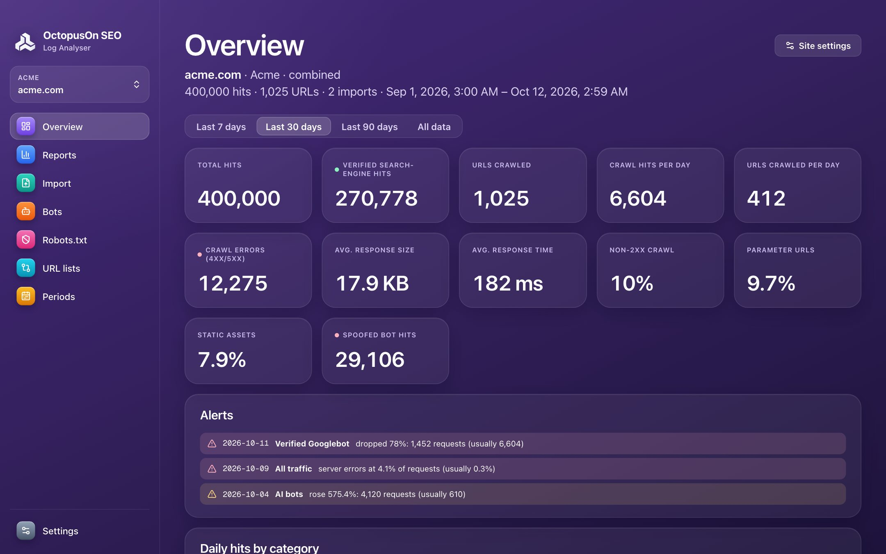

# OctopusOn Log Analyser

OctopusOn Log Analyser turns raw access logs into crawl insights: which pages Googlebot and AI crawlers fetch, where they hit errors, which bots are fake and where your crawl budget goes.

**100% free and open source** (no paid version, no trial, no limits) · for SEO and GEO (visibility in AI answers) · Windows, macOS and Linux · updated continuously as search engines and AI assistants change.



## Download

Get the installer for your system from the [latest release](../../releases/latest): `.dmg` for macOS (Apple Silicon and Intel), `.msi` or `.exe` for Windows, `.AppImage`, `.deb` or `.rpm` for Linux. More on [octopuson.com](https://octopuson.com/en/log-analyser).

## What it does

### Bot identification and verification

User agents are trivial to fake. Every bot hit is checked, so reports count real crawlers only.

- 110+ crawlers in categories: search, AI training, AI search, AI assistants, ads, SEO tools, social, monitoring
- Official IP lists of Google, Bing, OpenAI, Anthropic, Perplexity, Apple and more, plus forward-confirmed reverse DNS
- Verdict per hit: verified, spoofed or unverified — re-check any time
- Your own bots: custom user-agent patterns with IP ranges, IP list URLs or reverse DNS

### AI crawlers and AI search

Understand how AI platforms use your content — and what they send back.

- Daily activity of every AI crawler and the URLs it fetched
- Errors served to AI bots and assistants
- Human visits referred by AI assistants, with landing pages
- Bandwidth and estimated emissions per bot

### robots.txt compliance

Check every logged bot request against your live robots.txt or any version of it.

- Google-style evaluation: most specific user-agent group, longest match, Allow wins ties
- Disallowed requests per bot, from verified and from fake IPs
- Bots blocked site-wide, such as AI training crawlers
- Export every violation with the deciding rule

### Crawl budget and technical health

Find where crawlers waste time and what they cannot reach.

- URL summary: last status, last crawl, days since last crawl, size, speed and hits per bot
- Response codes per URL with 1xx–5xx columns and inconsistent responses
- Redirects, 4xx/5xx, slow and large URLs, parameter URLs, static files
- Alerts for crawl drops, spikes and server-error bursts

### Uncrawled and orphan pages

Combine your crawl data with what bots actually did.

- Crawler CSV exports, plain lists and XML sitemaps (with sitemap indexes)
- Listed but never crawled, crawled but not listed (orphans)
- All other columns of your export joined to the log data
- Period comparison per URL, directory or bot — before and after a migration

### Your data, your way

Fast, private and scriptable.

- Formats detected automatically; custom Nginx and Apache formats supported
- Import settings per site: bots only, include/exclude URLs, strip parameters
- Query language with saved queries; Excel, CSV and JSON exports
- Share a whole site as one archive; command-line tool for automation

## Command line

Every feature also works from the terminal with `octopuson-log`, included in the release archives:

```bash
octopuson-log import acme.com /var/log/nginx/
octopuson-log query acme.com --template url-summary -o urls.xlsx
```

## Your own APIs or OctopusOn credits

Everything that runs on your computer is free. Search APIs are optional: connect your own keys (DataForSEO, Serper, SerpApi, Yandex), or use all of them with prepaid credits through one connection at [my.octopuson.com](https://my.octopuson.com).

## Source code and issues

This project publishes the releases of the Log Analyser. Its source code lives in [octopusOn/octopusOnPageSEO](https://github.com/octopusOn/octopusOnPageSEO), together with the engine every OctopusOn SEO program shares. Bug reports and ideas are welcome in this project's issues.

## Licence

MIT or Apache-2.0, at your option.
