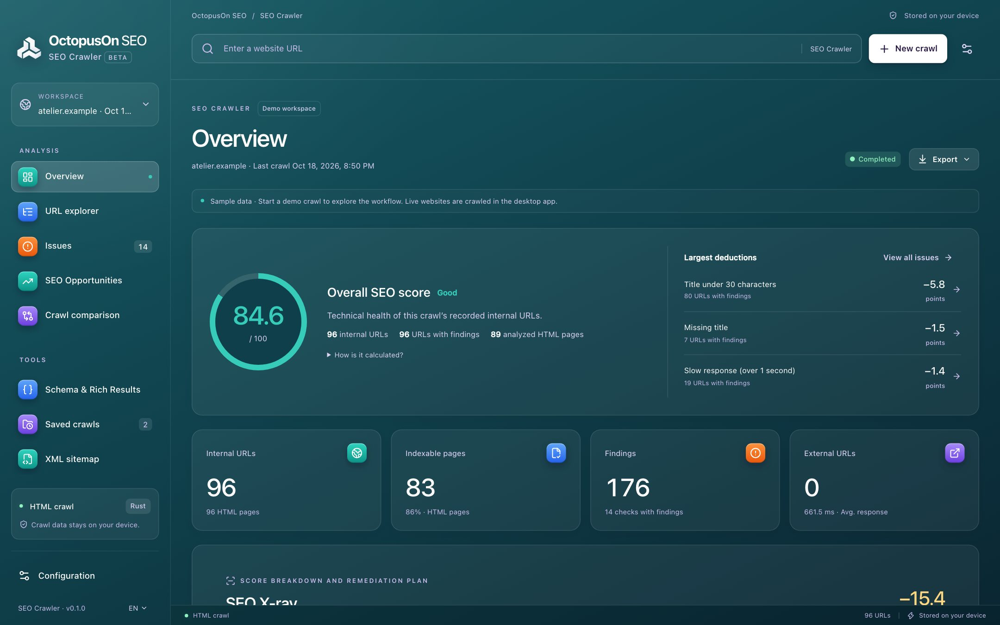

# OctopusOn SEO Crawler

A fast, local SEO crawler: see a site the way search engines do, and find what holds it back.

**100% free and open source** (no paid version, no trial, no limits) · for SEO and GEO (visibility in AI answers) · Windows, macOS and Linux · updated continuously as search engines and AI assistants change.



## Download

Get the installer for your system from the [latest release](../../releases/latest): `.dmg` for macOS (Apple Silicon and Intel), `.msi` or `.exe` for Windows, `.AppImage`, `.deb` or `.rpm` for Linux. More on [octopuson.com](https://octopuson.com/en/seo-crawler).

## What it does

### Crawl like a search engine

Crawl whole sites or URL lists with polite rate limits, robots.txt and sitemaps, as raw HTML or rendered in a real browser.

- JavaScript rendering with a local Chrome or Edge
- Compare raw and rendered HTML for JavaScript SEO
- Live progress, pause and resume, saved crawls to reopen

### An SEO score you can explain

Every finding has a priority and every deduction leads back to the URLs behind it.

- Titles, descriptions, headings, canonicals, hreflang, directives
- Redirect chains, broken links, duplicate and near-duplicate content
- System-by-system breakdown of the overall score

### Compare, export, build

Track how a site changes between crawls and hand results to your team.

- Crawl and finding comparisons
- Filtered exports to Excel, CSV and JSON
- XML sitemap builder

## Command line

Every feature also works from the terminal with `octopuson-crawler`, included in the release archives:

```bash
octopuson-crawler crawl https://example.com --render javascript
octopuson-crawler export latest --tab internal --out internal.xlsx
```

## Your own APIs or OctopusOn credits

Everything that runs on your computer is free. Search APIs are optional: connect your own keys (DataForSEO, Serper, SerpApi, Yandex), or use all of them with prepaid credits through one connection at [my.octopuson.com](https://my.octopuson.com).

## Source code and issues

This project publishes the releases of the SEO Crawler. Its source code lives in [octopusOn/octopusOnPageSEO](https://github.com/octopusOn/octopusOnPageSEO), together with the engine every OctopusOn SEO program shares. Bug reports and ideas are welcome in this project's issues.

## Licence

MIT or Apache-2.0, at your option.
