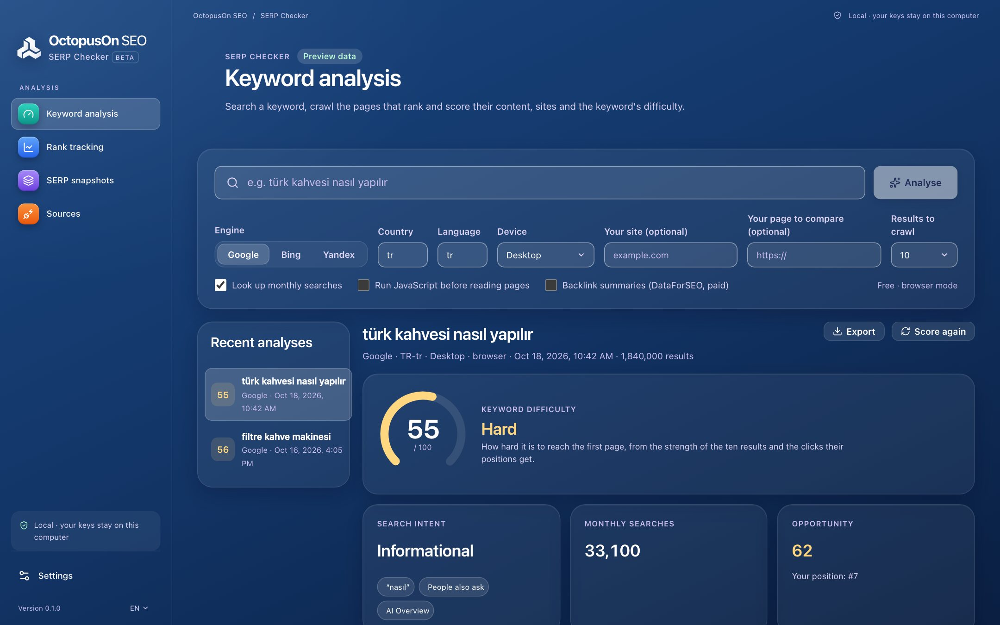

# OctopusOn SERP Checker

A free SERP checker and rank tracker: see where you rank on Google, Bing and Yandex in any country, spot SERP features and AI Overviews, and get a keyword difficulty built from crawling the pages that rank.

**100% free and open source** (no paid version, no trial, no limits) · for SEO and GEO (visibility in AI answers) · Windows, macOS and Linux · updated continuously as search engines and AI assistants change.



## Download

Get the installer for your system from the [latest release](../../releases/latest): `.dmg` for macOS (Apple Silicon and Intel), `.msi` or `.exe` for Windows, `.AppImage`, `.deb` or `.rpm` for Linux. More on [octopuson.com](https://octopuson.com/en/serp-checker).

## What it does

### Check rankings for free, or at scale with APIs

Start without any key, then add data sources when you need more volume, mobile results or page-level Google results.

- Free browser mode for Google, Bing and Yandex: a visible Chrome or Edge window, 30 seconds between searches and 100 searches per engine per day by default
- Optional APIs with your own key or OctopusOn credits: DataForSEO, Serper, SerpApi and the Yandex Search API
- Custom providers mapped with JSONPath, CSS selectors or regex
- Monthly budgets and a cost estimate before every run

### Keyword difficulty you can explain

Instead of a black-box number, the SERP analysis crawls the pages that rank and shows why a keyword is hard.

- Content, technical and site strength of every ranking page
- Domain age, Open PageRank and optional backlink data
- Difficulty in six bands, opportunity score and search intent
- Advice on word count, H2s, schema, title, questions to answer and content gaps

### Rank tracking with history and share of voice

Follow keyword positions over time for your site and your competitors.

- Daily, weekly or manual checks while the app is open, or from cron with the command line
- Position, change, best position, ranking URL and history
- Visibility and share of voice against competitors
- Cannibalisation warnings when several of your pages rank for one keyword

### SERP features, AI Overviews and stored result pages

See what else competes for the click on every result page.

- Ads, featured snippets, People Also Ask, local pack, images, videos, top stories, shopping and knowledge panels
- AI answers (Google AI Overviews, Yandex Neuro and Bing Copilot) lower the opportunity score
- Raw result pages are stored and can be read again later

## Command line

Every feature also works from the terminal with `octopuson-serp`, included in the release archives:

```bash
octopuson-serp analyze "türk kahvesi nasıl yapılır" --engine google --country tr --site example.com
octopuson-serp track --due
```

## Your own APIs or OctopusOn credits

Everything that runs on your computer is free. Search APIs are optional: connect your own keys (DataForSEO, Serper, SerpApi, Yandex), or use all of them with prepaid credits through one connection at [my.octopuson.com](https://my.octopuson.com).

## Source code and issues

This project publishes the releases of the SERP Checker. Its source code lives in [octopusOn/octopusOnPageSEO](https://github.com/octopusOn/octopusOnPageSEO), together with the engine every OctopusOn SEO program shares. Bug reports and ideas are welcome in this project's issues.

## Licence

MIT or Apache-2.0, at your option.
